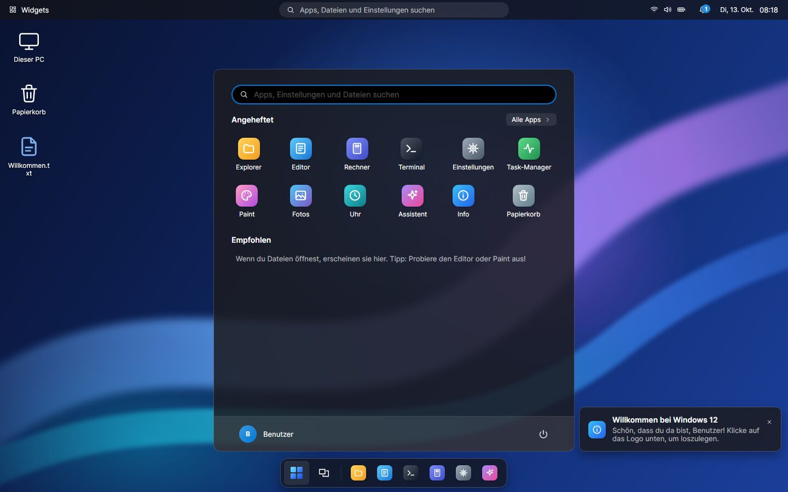
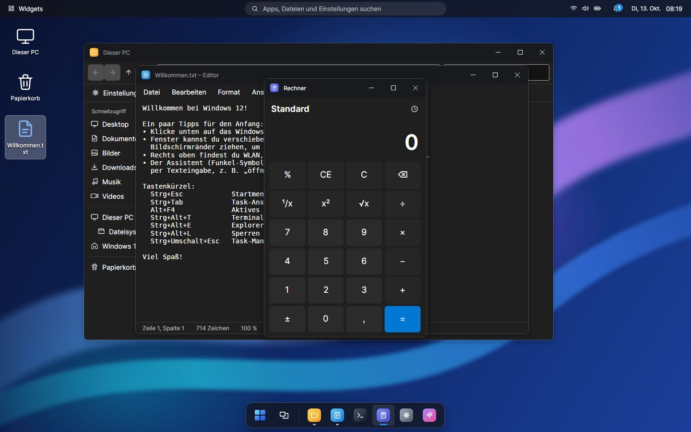
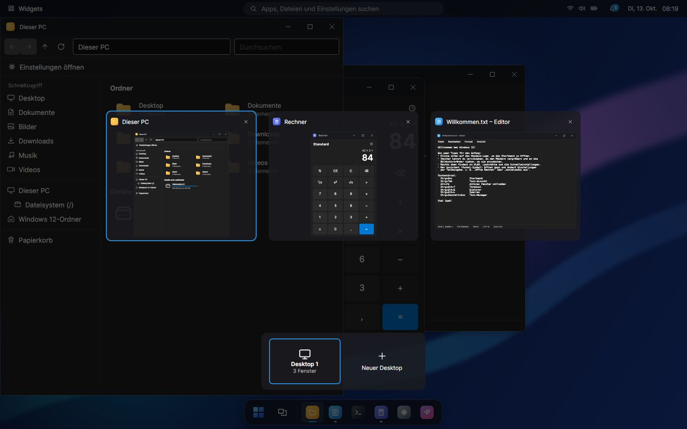
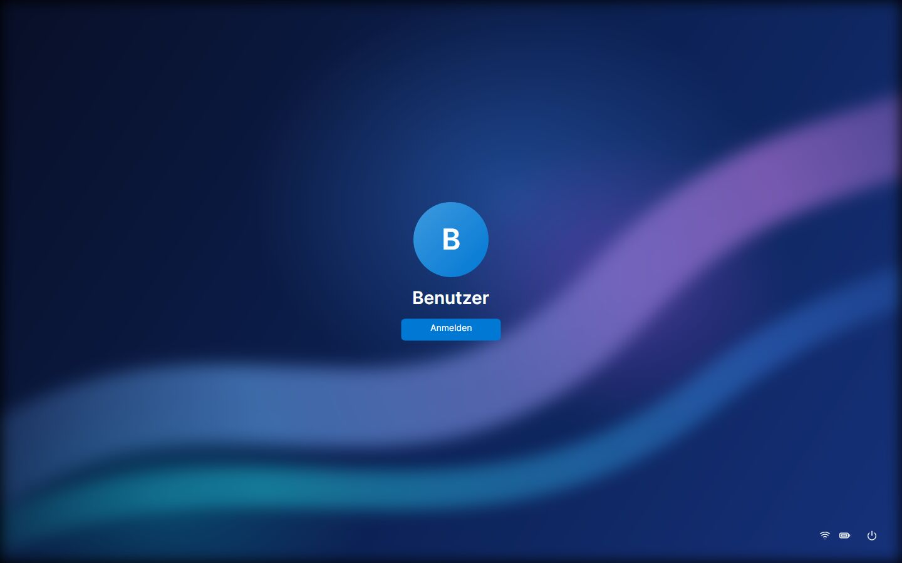
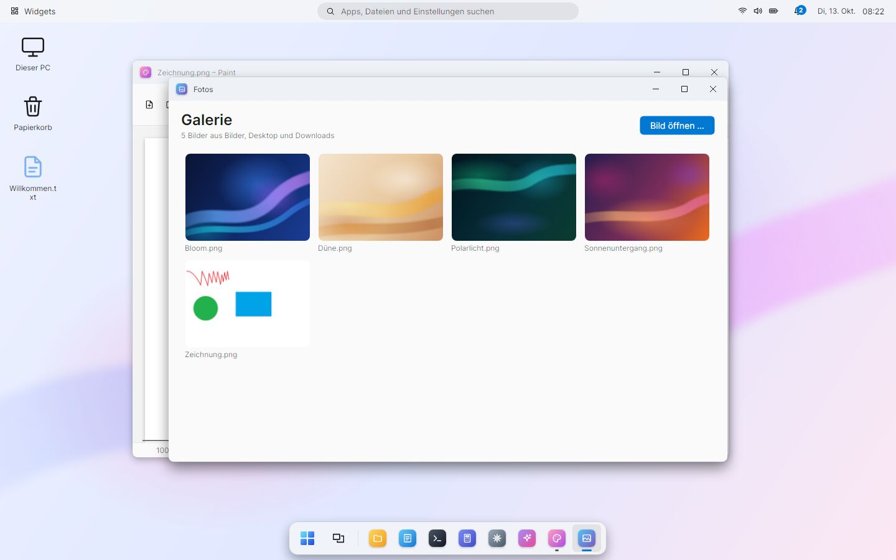

# Windows 12 – in C#

Eine komplette Desktop-Oberfläche im Stil eines „Windows 12“, geschrieben in **C# mit .NET 10 und
[Avalonia UI](https://avaloniaui.net/)**. Sie startet im Vollbild wie ein eigenes Betriebssystem:
Startbildschirm, Sperrbildschirm, Desktop, schwebende Taskleiste, Startmenü, Fenster und 12 Apps.

> Fan-Projekt – kein Produkt der Microsoft Corporation. „Windows“ ist eine Marke von Microsoft.



| Fenster & Apps | Task-Ansicht |
| --- | --- |
|  |  |
| **Anmeldung** | **Hellmodus** |
|  |  |

## Funktionen

**System & Oberfläche**

- Startanimation, Sperrbildschirm mit Uhr, Anmeldung (optional mit Kennwort), Sperren, Abmelden,
  Neu starten und Herunterfahren
- Desktop mit Symbolen (Dieser PC, Papierkorb, Dateien des Desktop-Ordners) und Kontextmenü
  (Neuer Ordner, Textdokument, Anpassen …)
- Schwebende Taskleiste: angeheftete und laufende Apps, Anzeige für aktive Fenster, Anheften/Lösen per Rechtsklick
- Obere Leiste: Widgets, Suche, WLAN/Lautstärke/Akku, Benachrichtigungen, Uhr mit Kalender
- Startmenü mit Suche über Apps, Einstellungen und Dateien – inklusive Rechner direkt im Suchfeld (`12*7`)
- Fenstermanager: verschieben, an allen Rändern skalieren, minimieren, maximieren, Doppelklick auf die
  Titelleiste, **Andocken** an linke/rechte Hälfte, Viertel (Ecken) und Maximieren (oben)
- **Task-Ansicht** mit Live-Vorschau aller Fenster und **virtuellen Desktops**
- Schnelleinstellungen: WLAN, Bluetooth, Flugmodus, Energie sparen, Nicht stören, Nachtmodus,
  Dunkelmodus, Transparenz, Helligkeit, Lautstärke
- Benachrichtigungen (Toasts) mit Benachrichtigungscenter
- Widgets: Uhr, Systeminfo, Notizen, Kalenderfakten, Tipps
- Hell-/Dunkelmodus, 12 Akzentfarben, 6 Hintergründe oder eigenes Bild
- Alles wird gespeichert (Einstellungen, angeheftete Apps, zuletzt verwendete Dateien, Notizen)

**Apps**

| App | Was sie kann |
| --- | --- |
| Explorer | Echtes Dateisystem, Laufwerke, Neu/Kopieren/Ausschneiden/Einfügen/Umbenennen/Löschen, Sortieren, Suchen, Eigenschaften |
| Papierkorb | Gelöschte Dateien wiederherstellen (an den Ursprungsort) oder endgültig löschen |
| Editor | Öffnen/Speichern, Suchen & Ersetzen, Zeilenumbruch, Zoom, Zeile/Spalte, Rückfrage bei ungespeicherten Änderungen |
| Rechner | Grundrechenarten, %, ¹/x, x², √, Verlauf, Tastatureingabe |
| Terminal | `dir`, `cd`, `mkdir`, `del`, `type`, `copy`, `ipconfig`, `ping`, `systeminfo`, `tasklist`, `calc` … – alles andere geht an die echte Shell |
| Einstellungen | System, Personalisierung, Netzwerk (echte Adapter), Konten & Kennwort, Zeit, Apps, Update, Info |
| Task-Manager | Offene Fenster, **echte Prozesse** des Computers (beenden möglich), CPU- und Speicherdiagramme |
| Paint | Stift, Radierer, Linie, Rechteck, Ellipse, Farben, Strichstärke, Rückgängig, Bilder öffnen, PNG speichern |
| Fotos | Galerie, Zoom, Verschieben, Drehen, Vor/Zurück, als Hintergrund festlegen |
| Uhr | Analoge Uhr, Weltzeit, Stoppuhr mit Runden, Timer und Wecker (laufen im Hintergrund weiter) |
| Assistent | Versteht deutsche Befehle: „öffne Paint“, „dunkelmodus aus“, „lautstärke 30“, „timer 5 minuten“, „15% von 240“, „suche einkauf“ … (lokal, ohne Internet) |
| Info | „Über Windows 12“ |

## Starten

Voraussetzung: [.NET 10 SDK](https://dotnet.microsoft.com/download/dotnet/10.0).

```bash
cd windows12
dotnet run                     # Vollbild – wie ein echtes Betriebssystem
dotnet run -- --fenster        # in einem normalen Fenster (1440 × 900)
dotnet run -- --autologin      # Sperrbildschirm überspringen
```

Beenden: **Start → Ein/Aus → Herunterfahren** oder **Alt+F4** auf dem leeren Desktop.

Alternativ `Windows12.csproj` in Visual Studio oder JetBrains Rider öffnen und starten.

### Als EXE für Windows

```bash
dotnet publish -c Release -r win-x64 --self-contained -p:PublishSingleFile=true -p:IncludeNativeLibrariesForSelfExtract=true -o publish
```

Ergebnis: `publish/Windows12.exe` – eine einzelne Datei, die ohne installiertes .NET läuft.
Für Linux bzw. macOS `-r linux-x64` bzw. `-r osx-arm64` verwenden.

## Tastenkürzel

| Kürzel | Aktion |
| --- | --- |
| Strg+Esc | Startmenü |
| Strg+Tab | Task-Ansicht |
| Alt+Tab | Zum nächsten Fenster wechseln |
| Alt+F4 | Aktives Fenster schließen (auf dem Desktop: Beenden-Dialog) |
| Strg+Alt+E / T / I | Explorer / Terminal / Einstellungen |
| Strg+Alt+R | Ausführen |
| Strg+Alt+L | Sperren |
| Strg+Alt+D | Desktop anzeigen |
| Strg+Alt+← / → | Virtuellen Desktop wechseln |
| Strg+Alt+↑ / ↓ | Fenster maximieren / minimieren |
| Strg+Umschalt+Esc | Task-Manager |

Auf einem echten Windows-PC fängt das Betriebssystem einige Kürzel (z. B. Windows-Taste, Strg+Umschalt+Esc)
selbst ab – dann einfach die Schaltflächen verwenden.

## Wo liegen die Daten?

Windows 12 arbeitet in einem eigenen Ordner, damit die Simulation keine echten Dateien durcheinanderbringt:

```
~/Windows12/                (Windows: C:\Users\<Name>\Windows12)
├── Desktop, Dokumente, Bilder, Downloads, Musik, Videos
├── Papierkorb
└── .system/einstellungen.json, papierkorb.json
```

Über „Dieser PC“ im Explorer sind trotzdem alle echten Laufwerke erreichbar. Mit der Umgebungsvariable
`W12_HOME` lässt sich ein anderer Ordner wählen. Zurücksetzen: Ordner löschen.

**Achtung:** Explorer, Terminal und Task-Manager arbeiten mit dem **echten** Computer. Dateien außerhalb des
Windows-12-Ordners, Shell-Befehle und das Beenden von Prozessen wirken sich also wirklich aus.
Gelöschte Dateien landen aber immer zuerst im Papierkorb.

## Was ist simuliert?

WLAN, Bluetooth, Flugmodus, Lautstärke und Akkuanzeige sind Schalter der Oberfläche – sie verändern
nicht die Hardware. Helligkeit und Nachtmodus wirken als Bildschirmfilter innerhalb von Windows 12.
„Windows Update“ prüft nur zum Schein.

## Projektstruktur

```
windows12/
├── Program.cs, App.axaml(.cs)   Start, Theme-Ressourcen und Stile
├── Core/                        Einstellungen, Ordner, Papierkorb, Symbole, Farben & Hintergründe, Formelrechner
├── Shell/                       Hauptfenster, Fenstermanager, Taskleiste, Startmenü, Flyouts,
│                                Sperr-/Startbildschirm, Dialoge, Desktop, Task-Ansicht
└── Apps/                        Die einzelnen Apps (je eine Datei)
```

Eine neue App: Klasse von `AppView` ableiten und in `Core/AppRegistry.cs` eintragen – sie erscheint dann
automatisch im Startmenü, in der Suche, im Terminal und beim Assistenten.

## Technik

- .NET 10, C# (neueste Sprachversion), Nullable aktiviert
- Avalonia 12 mit Fluent-Theme – plattformübergreifend (Windows, Linux, macOS)
- Oberfläche komplett im Code aufgebaut, Vektor-Symbole als Pfade, keine externen Grafiken
